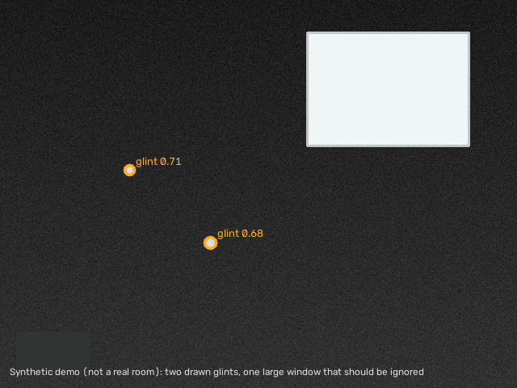

# Hidden Camera Detector

A small library, CLI (`hcd`), phone-friendly web UI, and Android app for spotting **likely** security cameras in a space you are staying in or have been asked to inspect. It combines three kinds of evidence:

1. **LAN discovery** — neighbor / ARP table, optional subnet sweep, MAC OUI lookup against a bundled camera-vendor list, probes of ports 554 (RTSP), 80, 8080, 8000, 37777, and 34567, plus ONVIF WS-Discovery, mDNS, and SSDP / UPnP.
2. **Bluetooth Low Energy** — advertisements scored against camera and tracker name patterns (live scan uses the optional `bleak` extra).
3. **Optics** — lens-glint detection (small, bright, circular, temporally stable reflections) and an IR-dot mode for night-vision LEDs that a phone sensor often sees as magenta or white specks.

None of these is definitive on its own. A matching Hikvision OUI plus an open RTSP port is a strong hint. An Espressif OUI alone is not: that chipset ships in cameras and in a lot of other IoT devices.

## Consent and ethics

**Only scan networks, rooms, and devices you are authorized to check.** Typical legitimate uses are a rental you are staying in, a hotel room, or your own home or office. Do not scan someone else's LAN, peek into rooms you do not have a right to be in, or use this to harass or surveil people.

This is a research / portfolio tool, not a guarantee that a space is free of cameras. Hidden cameras can be offline, wired, RF-quiet, or using a chipset OUI this repo does not treat as a camera vendor. Optical detection can light up jewelry, screws, and other shiny dots, and can miss a lens that is not reflecting back at you.

## Architecture

```text
                    +----------------------+
  CLI `hcd`  -----> |  hcd library (Python)| <----- FastAPI `hcd serve`
  Android app       |                      |           |
                    |  network / ble /     |           +--> /           phone web UI
                    |  vision              |                /v1/detect  image + video API
                    +----------------------+
```

- **Library-first.** Scoring, parsers, and the OpenCV blob detector live in `src/hcd/` and are imported by the CLI and the API. The Android app reimplements the same scoring ideas on-device (Kotlin) so a phone does not have to ship frames or LAN traffic to a server.
- **Mockable I/O.** `scan_network()` takes a `NetworkBackend`. Unit tests inject ARP rows, open ports, banners, and discovery records. CI never opens raw sockets or a radio.
- **Vendor data.** `src/hcd/data/camera_vendors.json` is a curated subset of the public [IEEE MA-L (OUI)](https://standards-oui.ieee.org/oui/oui.csv) list, grouped by brand and tagged `camera`, `mixed`, or `generic_iot`. Refresh it with `scripts/refresh_vendors.py`. A hit means the NIC was registered to that organization, not that the box is definitely a camera.

## Install

Python 3.11 or newer:

```bash
python -m venv .venv
source .venv/bin/activate
pip install -e ".[dev]"          # add [ble] for live Bluetooth scans
```

## Usage

```bash
# LAN (authorized networks only)
hcd network
hcd network --cidr 192.168.1.0/24 --json

# BLE (needs hidden-camera-detector[ble] and adapter permission)
hcd ble
hcd ble --from-json recordings/advertisements.json

# Optics: webcam, image, or video. --ir selects IR-dot mode.
hcd glint --source 0 --out annotated.png
hcd glint --file room.jpg --ir --json

# Phone-friendly UI + API (bind localhost by default)
hcd serve --host 127.0.0.1 --port 8080
# For a phone on your LAN, camera access needs HTTPS:
hcd serve --https --host 0.0.0.0 --port 8080
```

`hcd vendors` lists the bundled OUI groups. `hcd vendors --mac C0:56:E3:01:02:03` looks up one address.

## Phone web UI

`hcd serve` hosts a mobile layout at `/`:

- Live rear camera via `getUserMedia` (`facingMode: environment`)
- Flashlight / torch where the browser exposes `MediaTrackConstraints.torch` (often Android Chrome; not iOS Safari)
- In-browser lens-glint and IR-dot detection by default, so frames stay on the phone
- Optional “send frames to the server” toggle that posts JPEGs to `POST /v1/detect/image`
- Photo and video upload fallback (always uses the API, including an annotated image response)

The camera API requires a [secure context](https://developer.mozilla.org/en-US/docs/Web/Security/Secure_Contexts): HTTPS or `localhost`. On HTTP from a LAN IP, most mobile browsers will refuse `getUserMedia`; use `--https` and accept the short-lived self-signed certificate, or upload a photo instead.

API:

- `GET /v1/health`
- `POST /v1/detect/image` — form field `file`, `mode=glint|ir`, optional `annotate=true`
- `POST /v1/detect/video` — same fields, plus `max_frames` (capped)

## Android app

The Kotlin + Jetpack Compose app in `android/` runs the three detectors on the phone:

- **Camera** — CameraX preview, torch, in-app glint / IR detector
- **Network** — local IPv4 subnet TCP probes on the same camera ports, plus mDNS (`NsdManager`) and SSDP multicast. Modern Android does not expose other devices’ MAC addresses, so the app does not do OUI lookup on the LAN.
- **Bluetooth** — `BluetoothLeScanner` with the same name-pattern scoring as the Python library

Permissions are declared in `android/app/src/main/AndroidManifest.xml` and requested at runtime.

Build a debug APK (JDK 17 and the Android SDK):

```bash
cd android
./gradlew :app:assembleDebug
# APK: app/build/outputs/apk/debug/app-debug.apk
```

CI on `main` builds that APK with `actions/setup-java` when the workflow can reach the Android SDK.

### Android versus iOS scanning limits

| Capability | Android app | iOS (this repo’s web UI in Safari) |
|---|---|---|
| Rear camera + glint / IR | Yes (CameraX) | Yes in Safari over HTTPS; no torch in Safari |
| Flashlight / torch | Yes, when the device has a flash | Generally not exposed to web pages |
| Wi-Fi / LAN port sweep | Possible with location (and, on Android 13+, nearby-Wi-Fi) permission while connected to that LAN. Raw ARP and other devices’ MACs are not available to regular apps from Android 10 onward. | No general subnet or ARP scan. Local Network permission only covers some Bonjour use. |
| mDNS / SSDP | mDNS via `NsdManager`; SSDP via a multicast socket | Limited Bonjour; no raw SSDP from a web page |
| BLE scan | Yes, with `BLUETOOTH_SCAN` / `BLUETOOTH_CONNECT` (and location on older APIs) | Not available to this web UI; a native app would need Core Bluetooth and usage strings |
| OUI / vendor lookup | Only if you somehow have a MAC; the system will not give you neighbors’ MACs | Same limitation, plus no LAN inventory from the browser |

For a thorough LAN pass (OUI + RTSP + ONVIF), run `hcd network` from a laptop on the same Wi-Fi. Use the phone for optics, BLE, and a best-effort port / discovery sweep.

## Scoring (LAN)

Signals are added and then clipped to 0–100:

| Signal | Typical weight | Notes |
|---|---|---|
| Camera-vendor OUI (Hikvision, Dahua, Reolink, …) | +50 | IEEE registrant is primarily a camera / surveillance vendor |
| Mixed OUI (TP-Link, Tuya, Ubiquiti, Anker/Eufy registrant, Nest Labs) | +15 | That company also ships routers, APs, or other IoT |
| Generic IoT chipset (Espressif) | +5 | Weak alone |
| TCP 554 (RTSP) | +35 | |
| TCP 37777 (Dahua / Amcrest) or 34567 (XM / Sofia kits) | +30 | |
| ONVIF, `_rtsp._tcp`, or `_axis-video._tcp` | +40 | |
| Strong HTTP `Server` fingerprint | +25 | |
| Camera-like hostname | +20 | |
| HTTP 80 / 8080 / 8000 | +5 each | Weak alone |

Bands: 0–19 unlikely, 20–39 possible, 40–69 likely, 70–100 highly likely.

## Tests and synthetic metrics

Unit tests use **drawn** images and **mocked** network results. They do not scan a real LAN, radio, or camera.

The labelled synthetic set in `hcd.vision.synthetic` (dark gradient “rooms,” drawn glints, magenta IR dots, plus negatives: empty frame, large window, long streak, huge bright disc) is a fixture for the blob detector. It is **not** a photograph of hidden cameras.

On the checked-in labelled fixture set (`hcd.vision.synthetic.build_fixture_set`, also stored as `docs/img/synthetic_metrics.json` after `hcd demo`):

| Set | Frames | True positives | False positives | False negatives | Precision | Recall |
|---|---|---|---|---|---|---|
| synthetic-glint | 6 | 3 | 0 | 0 | 1.0 | 1.0 |
| synthetic-ir | 3 | 3 | 0 | 0 | 1.0 | 1.0 |

These figures only measure whether the detector finds the dots we drew. They are **not** real-world accuracy and should not be cited as such. Regenerate them with `make demo` if you change the fixtures or the detector.

```bash
pytest
make demo    # writes docs/img/demo_glint.png and docs/img/synthetic_metrics.json
```



## Limitations

- A camera can be powered off, on a different VLAN or guest network, cellular-only, or using a randomized / chipset MAC this list does not treat as a camera brand.
- Optical mode needs a light source (phone torch or flashlight) almost on-axis with the lens, and a reasonably steady aim so a glint can persist across frames. It will false-positive on other small shiny objects.
- IR mode depends on the phone sensor’s IR cutoff. Many rear cameras filter IR more aggressively than front cameras.
- Android LAN mode cannot read the ARP table, so it cannot do vendor lookup from MACs.
- This project does not include an iOS app. iOS network scanning is tightly restricted; the web UI covers camera (and upload) only.

## License

MIT. Vendor prefixes come from the public IEEE Registration Authority MA-L listing; see the `source` field in `src/hcd/data/camera_vendors.json`.
